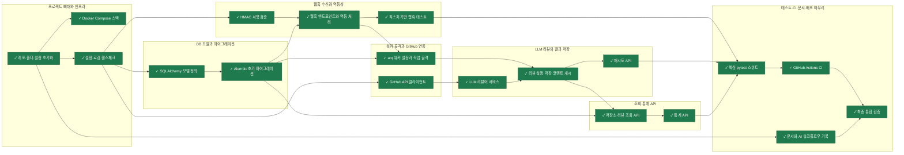

# PR Review Assistant — 구현 절차

이 문서는 계획서를 단계별 작업으로 나눈 결과와 진행 상황을 기록합니다. 표식 주석(`mla:`) 안쪽은 앱이 갱신하고, 바깥에 쓴 글은 그대로 남습니다.

## 개요

<!-- mla:overview:start -->
전체 진행률 **100%** · 완료 19/19개 작업

`████████████████████` 100%

마지막 갱신: 2026-11-17 09:44 (UTC)

> **계획서 요약**: # PR Review Assistant 프로젝트 계획 > GitHub PR을 자동으로 리뷰하는 FastAPI 서비스. 채용 공고의 기술 스택과 AI 활용 개발 경험을 한 프로젝트로 증명하는 포트폴리오. ## 0. 목표와 전제 - **목표:** 공고의 자격·우대 요건(Python/FastAPI, PostgreSQL, Redis, Docker, Linux, Git 협업, AI 개발 도구 활용·자동화)을 한 프로젝트로 증명한다. - **가정(변경 가능):** 1인 개발, 4주, 평일 저녁과 주말 투자, LLM API 비용 최소화. ## …
<!-- mla:overview:end -->

## 단계 표

<!-- mla:table:start -->
| 마일스톤 | 작업 | 상태 | 선행 | 완료 조건 |
| --- | --- | --- | --- | --- |
| 프로젝트 뼈대와 인프라 | t1 레포·폴더·설정 초기화 | ✓ 완료 | - | 폴더 구조가 계획과 일치하고 pyproject.toml에 FastAPI/SQLAlchemy/arq 등 의존성이 선언되어 있다. |
| 프로젝트 뼈대와 인프라 | t2 Docker Compose 스택 | ✓ 완료 | t1 | docker compose up -d 후 api:8000, db, redis가 정상 기동되고 postgres healthcheck가 통과한다. |
| 프로젝트 뼈대와 인프라 | t3 설정·로깅·헬스체크 | ✓ 완료 | t1 | GET /health가 200과 {"status":"ok"}를 반환하고 환경변수가 config로 로드된다. |
| DB 모델과 마이그레이션 | t4 SQLAlchemy 모델 정의 | ✓ 완료 | t3 | 모델이 계획서 스키마와 일치하고 session/engine이 설정되어 있다. |
| DB 모델과 마이그레이션 | t5 Alembic 초기 마이그레이션 | ✓ 완료 | t4 | alembic upgrade head가 성공하고 네 테이블과 인덱스가 생성된다. |
| 웹훅 수신과 멱등성 | t6 HMAC 서명 검증 | ✓ 완료 | t3 | 올바른 서명 요청은 통과하고 잘못된/없는 서명은 401을 반환한다. |
| 웹훅 수신과 멱등성 | t7 웹훅 엔드포인트와 멱등 처리 | ✓ 완료 | t6, t5 | 동일 repo+pr+sha 재요청 시 duplicate_ignored를 반환하고 새 요청만 큐에 적재된다. |
| 웹훅 수신과 멱등성 | t8 픽스처 기반 웹훅 테스트 | ✓ 완료 | t7 | pytest tests/test_webhooks.py가 통과하고 중복 요청 테스트가 포함된다. |
| 워커 골격과 GitHub 연동 | t9 arq 워커 설정과 작업 골격 | ✓ 완료 | t5, t7 | docker compose로 worker가 기동되고 큐 작업을 받아 review 레코드를 running으로 갱신한다. |
| 워커 골격과 GitHub 연동 | t10 GitHub API 클라이언트 | ✓ 완료 | t3 | 실제 또는 모킹된 호출로 diff 문자열과 코멘트 생성 API가 동작한다. |
| LLM 리뷰와 결과 저장 | t11 LLM 리뷰어 서비스 | ✓ 완료 | t10 | 모킹 모드에서 고정 응답이 나오고, 실모드 호출 시 summary·comments·token 수가 반환된다. |
| LLM 리뷰와 결과 저장 | t12 리뷰 실행·저장·코멘트 게시 | ✓ 완료 | t9, t11 | 성공 시 review가 done이고 코멘트가 DB·GitHub에 남으며, 강제 실패 시 failed와 error가 기록된다. |
| LLM 리뷰와 결과 저장 | t13 재시도 API | ✓ 완료 | t12 | failed 상태 리뷰에 대해 재시도 요청 시 새 작업이 큐에 들어가고 status가 queued로 바뀐다. |
| 조회·통계 API | t14 저장소·리뷰 조회 API | ✓ 완료 | t5, t12 | 페이지네이션과 필터가 동작하고 상세 응답에 review_comments가 포함된다. |
| 조회·통계 API | t15 통계 API | ✓ 완료 | t14 | 집계 쿼리가 올바른 숫자와 분포를 반환한다. |
| 테스트·CI·문서·배포 마무리 | t16 핵심 pytest 스위트 | ✓ 완료 | t8, t13, t15 | pytest가 전부 통과하고 커버리지가 핵심 경로를 포함한다. |
| 테스트·CI·문서·배포 마무리 | t17 GitHub Actions CI | ✓ 완료 | t16 | PR 생성 시 CI가 통과한다. |
| 테스트·CI·문서·배포 마무리 | t18 문서와 AI 워크플로우 기록 | ✓ 완료 | t1 | README만으로 로컬 실행이 가능하고 ai-workflow.md에 최소 5개 사례가 있다. |
| 테스트·CI·문서·배포 마무리 | t19 최종 통합 검증 | ✓ 완료 | t17, t18 | 완료 체크리스트 항목이 모두 충족되고 데모 가능한 상태가 된다. |
<!-- mla:table:end -->

## 단계별 상세

<!-- mla:detail:start -->
### 프로젝트 뼈대와 인프라 (100%)

#### ✓ t1 레포·폴더·설정 초기화 — 완료
- 내용: 프로젝트 루트 구조(app/, alembic/, tests/, docs/, .github/)를 만들고 pyproject.toml, .env.example, README 초안, .gitignore를 작성한다.
- 파일: `pyproject.toml`, `.env.example`, `README.md`, `.gitignore`, `app/__init__.py`
- 완료 조건: 폴더 구조가 계획과 일치하고 pyproject.toml에 FastAPI/SQLAlchemy/arq 등 의존성이 선언되어 있다.
- 완료 시각: 2026-11-17 09:23

#### ✓ t2 Docker Compose 스택 — 완료
- 내용: docker-compose.yml과 Dockerfile을 작성해 api, worker, postgres, redis 서비스를 정의하고 healthcheck를 넣는다.
- 파일: `docker-compose.yml`, `Dockerfile`
- 완료 조건: docker compose up -d 후 api:8000, db, redis가 정상 기동되고 postgres healthcheck가 통과한다.
- 선행 작업: t1
- 완료 시각: 2026-11-17 09:24

#### ✓ t3 설정·로깅·헬스체크 — 완료
- 내용: app/core/config.py( pydantic-settings ), logging.py, main.py에 /health 엔드포인트를 구현한다.
- 파일: `app/core/config.py`, `app/core/logging.py`, `app/main.py`
- 완료 조건: GET /health가 200과 {"status":"ok"}를 반환하고 환경변수가 config로 로드된다.
- 선행 작업: t1
- 완료 시각: 2026-11-17 09:26

### DB 모델과 마이그레이션 (100%)

#### ✓ t4 SQLAlchemy 모델 정의 — 완료
- 내용: repositories, pull_requests, reviews, review_comments 테이블을 SQLAlchemy 2.0 모델로 작성한다.
- 파일: `app/db/models.py`, `app/db/session.py`
- 완료 조건: 모델이 계획서 스키마와 일치하고 session/engine이 설정되어 있다.
- 선행 작업: t3
- 완료 시각: 2026-11-17 09:28

#### ✓ t5 Alembic 초기 마이그레이션 — 완료
- 내용: Alembic을 초기화하고 모델 기준 첫 마이그레이션을 생성·적용한다.
- 파일: `alembic.ini`, `alembic/env.py`, `alembic/versions/`
- 완료 조건: alembic upgrade head가 성공하고 네 테이블과 인덱스가 생성된다.
- 선행 작업: t4
- 완료 시각: 2026-11-17 09:29

### 웹훅 수신과 멱등성 (100%)

#### ✓ t6 HMAC 서명 검증 — 완료
- 내용: GitHub 웹훅 서명(HMAC-SHA256) 검증 유틸과 미들웨어/의존성을 구현한다.
- 파일: `app/core/security.py`
- 완료 조건: 올바른 서명 요청은 통과하고 잘못된/없는 서명은 401을 반환한다.
- 선행 작업: t3
- 완료 시각: 2026-11-17 09:30

#### ✓ t7 웹훅 엔드포인트와 멱등 처리 — 완료
- 내용: POST /webhooks/github에서 PR opened/synchronize 이벤트를 파싱하고 Redis SET NX로 멱등 키를 검사한 뒤 큐에 작업을 넣는다.
- 파일: `app/api/webhooks.py`, `app/main.py`
- 완료 조건: 동일 repo+pr+sha 재요청 시 duplicate_ignored를 반환하고 새 요청만 큐에 적재된다.
- 선행 작업: t6, t5
- 완료 시각: 2026-11-17 09:31

#### ✓ t8 픽스처 기반 웹훅 테스트 — 완료
- 내용: 저장된 GitHub 페이로드 픽스처로 서명 검증·멱등·큐 적재를 pytest로 검증한다.
- 파일: `tests/fixtures/`, `tests/test_webhooks.py`
- 완료 조건: pytest tests/test_webhooks.py가 통과하고 중복 요청 테스트가 포함된다.
- 선행 작업: t7
- 완료 시각: 2026-11-17 09:31

### 워커 골격과 GitHub 연동 (100%)

#### ✓ t9 arq 워커 설정과 작업 골격 — 완료
- 내용: app/worker/settings.py와 tasks.py에 run_review 작업을 정의하고 상태(queued→running)를 DB에 반영한다.
- 파일: `app/worker/settings.py`, `app/worker/tasks.py`
- 완료 조건: docker compose로 worker가 기동되고 큐 작업을 받아 review 레코드를 running으로 갱신한다.
- 선행 작업: t5, t7
- 완료 시각: 2026-11-17 09:32

#### ✓ t10 GitHub API 클라이언트 — 완료
- 내용: PR diff 조회와 코멘트 작성 기능을 가진 github_client를 구현한다(토큰·App 인증).
- 파일: `app/services/github_client.py`
- 완료 조건: 실제 또는 모킹된 호출로 diff 문자열과 코멘트 생성 API가 동작한다.
- 선행 작업: t3
- 완료 시각: 2026-11-17 09:33

### LLM 리뷰와 결과 저장 (100%)

#### ✓ t11 LLM 리뷰어 서비스 — 완료
- 내용: diff를 입력받아 요약·파일별 코멘트(severity)를 생성하는 llm_reviewer를 구현하고 토큰 사용량을 반환한다. 모킹 모드를 지원한다.
- 파일: `app/services/llm_reviewer.py`
- 완료 조건: 모킹 모드에서 고정 응답이 나오고, 실모드 호출 시 summary·comments·token 수가 반환된다.
- 선행 작업: t10
- 완료 시각: 2026-11-17 09:34

#### ✓ t12 리뷰 실행·저장·코멘트 게시 — 완료
- 내용: 워커에서 diff 조회 → LLM 호출 → reviews/review_comments 저장 → GitHub PR 코멘트 게시 → status=done/failed 처리를 완성한다. 실패 시 재시도 로직을 포함한다.
- 파일: `app/worker/tasks.py`, `app/db/models.py`
- 완료 조건: 성공 시 review가 done이고 코멘트가 DB·GitHub에 남으며, 강제 실패 시 failed와 error가 기록된다.
- 선행 작업: t9, t11
- 완료 시각: 2026-11-17 09:35

#### ✓ t13 재시도 API — 완료
- 내용: POST /reviews/{id}/retry로 failed 리뷰를 다시 큐에 넣는 엔드포인트를 구현한다.
- 파일: `app/api/reviews.py`
- 완료 조건: failed 상태 리뷰에 대해 재시도 요청 시 새 작업이 큐에 들어가고 status가 queued로 바뀐다.
- 선행 작업: t12
- 완료 시각: 2026-11-17 09:36

### 조회·통계 API (100%)

#### ✓ t14 저장소·리뷰 조회 API — 완료
- 내용: GET /repositories, GET /repositories/{id}/reviews(페이지·status 필터), GET /reviews/{id}(코멘트 포함)를 구현한다.
- 파일: `app/api/reviews.py`, `app/api/repositories.py`, `app/main.py`
- 완료 조건: 페이지네이션과 필터가 동작하고 상세 응답에 review_comments가 포함된다.
- 선행 작업: t5, t12
- 완료 시각: 2026-11-17 09:37

#### ✓ t15 통계 API — 완료
- 내용: GET /stats/summary로 저장소별 리뷰 수, severity 분포, 토큰 사용량 집계를 제공한다.
- 파일: `app/api/stats.py`
- 완료 조건: 집계 쿼리가 올바른 숫자와 분포를 반환한다.
- 선행 작업: t14
- 완료 시각: 2026-11-17 09:37

### 테스트·CI·문서·배포 마무리 (100%)

#### ✓ t16 핵심 pytest 스위트 — 완료
- 내용: 웹훅, 멱등, 워커 상태 전이, 조회 API, 통계를 커버하는 테스트를 작성한다(LLM·GitHub은 모킹).
- 파일: `tests/`
- 완료 조건: pytest가 전부 통과하고 커버리지가 핵심 경로를 포함한다.
- 선행 작업: t8, t13, t15
- 완료 시각: 2026-11-17 09:39

#### ✓ t17 GitHub Actions CI — 완료
- 내용: lint(ruff/mypy), pytest, docker build를 수행하는 .github/workflows/ci.yml을 작성한다.
- 파일: `.github/workflows/ci.yml`
- 완료 조건: PR 생성 시 CI가 통과한다.
- 선행 작업: t16
- 완료 시각: 2026-11-17 09:40

#### ✓ t18 문서와 AI 워크플로우 기록 — 완료
- 내용: docs/architecture.md, docs/ai-workflow.md(사례 5개 이상), README에 아키텍처·실행 방법·데모 안내를 완성한다. PR 템플릿도 추가한다.
- 파일: `docs/architecture.md`, `docs/ai-workflow.md`, `README.md`, `.github/pull_request_template.md`
- 완료 조건: README만으로 로컬 실행이 가능하고 ai-workflow.md에 최소 5개 사례가 있다.
- 선행 작업: t1
- 완료 시각: 2026-11-17 09:43

#### ✓ t19 최종 통합 검증 — 완료
- 내용: docker compose up 전체 스택으로 웹훅→리뷰→조회→통계 흐름을 end-to-end로 확인하고 완료 체크리스트를 충족한다.
- 파일: `README.md`
- 완료 조건: 완료 체크리스트 항목이 모두 충족되고 데모 가능한 상태가 된다.
- 선행 작업: t17, t18
- 완료 시각: 2026-11-17 09:44
<!-- mla:detail:end -->

## 진행 요약

<!-- mla:progress:start -->
| 상태별 작업 수 | # | |
| --- | ---: | --- |
| ○ 대기 | 0 | `░░░░░░░░░░░░` |
| ▶ 진행 중 | 0 | `░░░░░░░░░░░░` |
| ◐ 검증 중 | 0 | `░░░░░░░░░░░░` |
| ✓ 완료 | 19 | `████████████` |
| ✕ 막힘 | 0 | `░░░░░░░░░░░░` |

- 마일스톤 프로젝트 뼈대와 인프라: `████████████` 100%
- 마일스톤 DB 모델과 마이그레이션: `████████████` 100%
- 마일스톤 웹훅 수신과 멱등성: `████████████` 100%
- 마일스톤 워커 골격과 GitHub 연동: `████████████` 100%
- 마일스톤 LLM 리뷰와 결과 저장: `████████████` 100%
- 마일스톤 조회·통계 API: `████████████` 100%
- 마일스톤 테스트·CI·문서·배포 마무리: `████████████` 100%

**선행 관계 지도**

<!-- mla:progress:end -->

## 변경 이력

<!-- mla:history:start -->
- 2026-11-17 09:44 — t19 최종 통합 검증: ✓ 완료
- 2026-11-17 09:43 — t19 최종 통합 검증: ▶ 진행 중
- 2026-11-17 09:43 — t18 문서와 AI 워크플로우 기록: ✓ 완료
- 2026-11-17 09:40 — t18 문서와 AI 워크플로우 기록: ▶ 진행 중
- 2026-11-17 09:40 — t17 GitHub Actions CI: ✓ 완료
- 2026-11-17 09:39 — t17 GitHub Actions CI: ▶ 진행 중
- 2026-11-17 09:39 — t16 핵심 pytest 스위트: ✓ 완료
- 2026-11-17 09:37 — t16 핵심 pytest 스위트: ▶ 진행 중
- 2026-11-17 09:37 — t15 통계 API: ✓ 완료
- 2026-11-17 09:37 — t15 통계 API: ▶ 진행 중
- 2026-11-17 09:37 — t14 저장소·리뷰 조회 API: ✓ 완료
- 2026-11-17 09:36 — t14 저장소·리뷰 조회 API: ▶ 진행 중
- 2026-11-17 09:36 — t13 재시도 API: ✓ 완료
- 2026-11-17 09:35 — t13 재시도 API: ▶ 진행 중
- 2026-11-17 09:35 — t12 리뷰 실행·저장·코멘트 게시: ✓ 완료
- 2026-11-17 09:34 — t12 리뷰 실행·저장·코멘트 게시: ▶ 진행 중
- 2026-11-17 09:34 — t11 LLM 리뷰어 서비스: ✓ 완료
- 2026-11-17 09:33 — t11 LLM 리뷰어 서비스: ▶ 진행 중
- 2026-11-17 09:33 — t10 GitHub API 클라이언트: ✓ 완료
- 2026-11-17 09:32 — t10 GitHub API 클라이언트: ▶ 진행 중
- 2026-11-17 09:32 — t9 arq 워커 설정과 작업 골격: ✓ 완료
- 2026-11-17 09:31 — t9 arq 워커 설정과 작업 골격: ▶ 진행 중
- 2026-11-17 09:31 — t8 픽스처 기반 웹훅 테스트: ✓ 완료
- 2026-11-17 09:31 — t8 픽스처 기반 웹훅 테스트: ▶ 진행 중
- 2026-11-17 09:31 — t7 웹훅 엔드포인트와 멱등 처리: ✓ 완료
- 2026-11-17 09:30 — t7 웹훅 엔드포인트와 멱등 처리: ▶ 진행 중
- 2026-11-17 09:30 — t6 HMAC 서명 검증: ✓ 완료
- 2026-11-17 09:29 — t6 HMAC 서명 검증: ▶ 진행 중
- 2026-11-17 09:29 — t5 Alembic 초기 마이그레이션: ✓ 완료
- 2026-11-17 09:28 — t5 Alembic 초기 마이그레이션: ▶ 진행 중
- 2026-11-17 09:28 — t4 SQLAlchemy 모델 정의: ✓ 완료
- 2026-11-17 09:26 — t4 SQLAlchemy 모델 정의: ▶ 진행 중
- 2026-11-17 09:26 — t3 설정·로깅·헬스체크: ✓ 완료
- 2026-11-17 09:24 — t3 설정·로깅·헬스체크: ▶ 진행 중
- 2026-11-17 09:24 — t2 Docker Compose 스택: ✓ 완료
- 2026-11-17 09:23 — t2 Docker Compose 스택: ▶ 진행 중
- 2026-11-17 09:23 — t1 레포·폴더·설정 초기화: ✓ 완료
- 2026-11-17 09:21 — t1 레포·폴더·설정 초기화: ▶ 진행 중
<!-- mla:history:end -->
